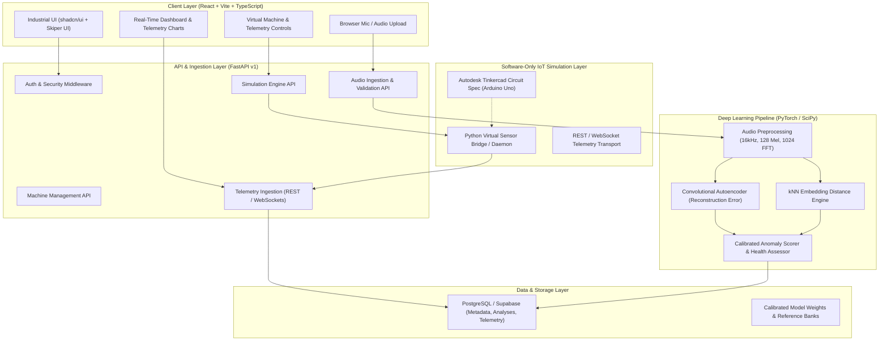
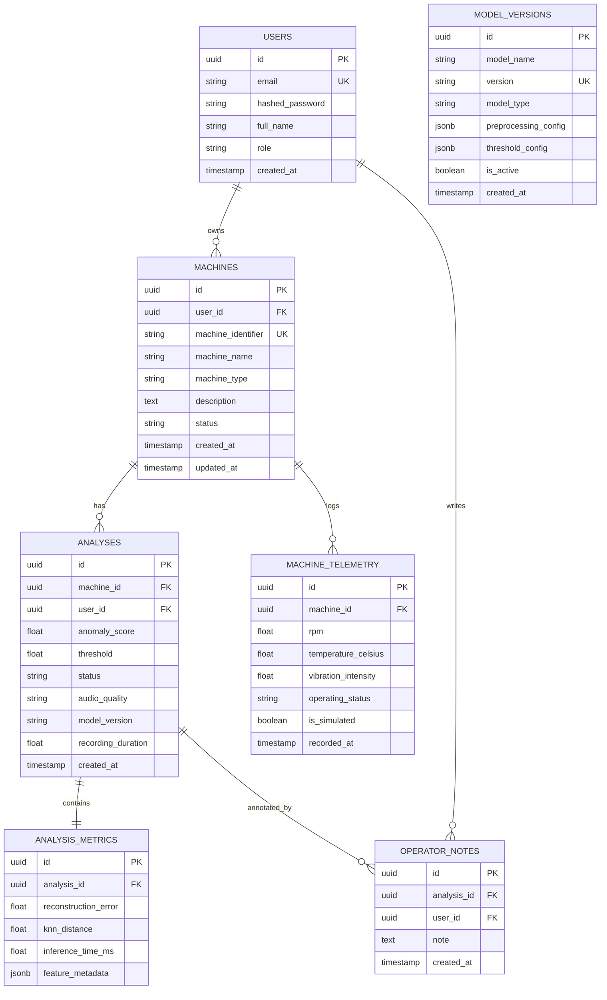

# PulseGuard System Architecture Document

## 1. System Overview

PulseGuard is a software-only industrial acoustic anomaly detection and predictive maintenance platform designed to detect operational degradations in industrial rotating machinery (fans, pumps, slide rails, valves). It combines a deep learning pipeline (log-Mel spectrogram extraction, Convolutional Autoencoder, kNN embedding baseline) with a real-time virtual IoT sensor telemetry subsystem (simulating virtual microcontroller nodes, TMP36 temperature sensors, potentiometer vibration proxies, and pulse tachometers).

---

## 2. Audio Processing & Deep Learning Architecture

### 2.1 Acoustic Signal Pipeline
1. **Audio Ingestion & Quality Validation:**
   - Enforce WAV format, maximum file size (15 MB), duration (3–10 seconds), single/stereo channel check (stereo automatically downmixed to mono).
   - Signal checks: Root Mean Square (RMS) silence threshold test, clipping ratio test (> 1% clipped samples triggers warning), signal-to-noise ratio check.
2. **Standardized Preprocessing:**
   - Resampling: Standardized to 16,000 Hz using high-quality polyphase filtering.
   - Framing & Windowing: 1024-point Hann window, 512-sample hop size (50% overlap).
   - Frequency representation: 128 Mel-scale filter banks spanning 0 Hz to 8,000 Hz.
   - Power to Decibels: `S_db = 10 * log10(max(S, 1e-10)) - 10 * log10(max(S))` normalized to [-80 dB, 0 dB] range, scaled to [0, 1].
3. **Primary Anomaly Model — Convolutional Autoencoder (CAE):**
   - **Encoder:** 4 convolutional blocks (Conv2d -> BatchNorm -> LeakyReLU -> MaxPool2d), channels: `[1 -> 32 -> 64 -> 128 -> 256]`.
   - **Bottleneck:** Low-dimensional latent representation preserving fundamental normal acoustic operating signatures.
   - **Decoder:** 4 transposed convolutional blocks (ConvTranspose2d -> BatchNorm -> LeakyReLU) restoring original spectrogram dimensions.
   - **Loss Function:** Mean Squared Error (MSE) between normalized input and reconstructed spectrogram:
     $$\mathcal{L}_{recon}(X, \hat{X}) = \frac{1}{B \cdot F \cdot T} \sum_{b, f, t} (X_{b,f,t} - \hat{X}_{b,f,t})^2$$
   - **Training Paradigm:** Strictly unsupervised on normal acoustic recordings. Normal machinery reconstructs with minimal MSE; novel anomalous signatures exhibit elevated reconstruction residuals.
4. **Secondary Baseline — kNN Latent Embedding Distance:**
   - Extracts bottleneck representations from CAE encoder.
   - Measures Euclidean distance against a pre-indexed vector bank of verified normal machine states.
5. **Threshold Calibration:**
   - Calibrated using 95th/99th percentiles of validation normal samples.
   - Supports machine-specific thresholds to avoid cross-machine false alarms.

---

## 3. Software-Only IoT Simulation & Telemetry Architecture

### 3.1 Design Principle
Physical sensor boards (ESP32, Arduino hardware) are strictly prohibited per project specifications. The IoT layer is modeled as an **academic industrial virtual simulator**:
- **Reference Virtual Hardware:** Autodesk Tinkercad Circuits platform simulating an Arduino Uno connected to:
  - TMP36 Temperature Sensor (Analog input A0, calibrated for -40°C to +125°C).
  - 10kΩ Potentiometer (Analog input A1, serving as an explicit **vibration proxy indicator**).
  - Optical Tachometer / Pulse Sensor (Digital Pin 2 interrupt, measuring RPM).
  - Status LEDs (Green = Normal, Yellow = Warning, Red = Critical) & Piezo Buzzer.
- **Virtual Sensor Bridge:** A decoupled Python process (`iot/bridge/virtual_sensor_bridge.py`) that emulates the exact serial/JSON stream of the Tinkercad circuit and securely streams telemetry to FastAPI via REST `/api/v1/telemetry/ingest` and pushes live updates to connected frontends via WebSocket `/api/v1/telemetry/ws/{machine_id}`.
- **Explainable Multi-Modal Health Assessment:**
  Acoustic anomaly score is the primary deep-learning metric. IoT sensor metrics (RPM deviation, thermal surge, vibration proxy) provide secondary contextual evidence.

---

## 4. Relational Database Schema (PostgreSQL)

---

## 5. Security Architecture

1. **Authentication & Authorization:** JWT-based stateless authentication with password hashing (PBKDF2/bcrypt) and strict user-tenant row isolation.
2. **Audio Upload Security:**
   - Magic byte header inspection (enforcing `RIFF....WAVE`).
   - File size caps (15 MB).
   - In-memory temporary buffer processing; no persistent raw files saved to disk without sanitization.
3. **CORS & Headers:** Restricted origins, Content-Security-Policy headers, rate-limiting on inference and ingestion endpoints.

